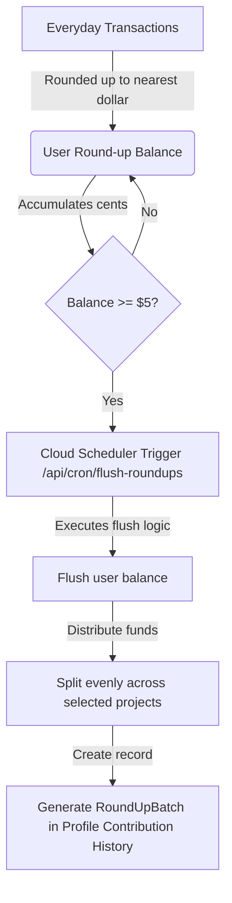

# Berry Bank Green Hub

A full-stack environmental project management platform built with React, Express, Mongoose, and MongoDB.

## 🚀 Quick Start (Zero-Config Dev)

The application now supports an **In-Memory MongoDB** for development. You do not need to install MongoDB locally to get started.

### Run the Application

```bash
npm install
npm run dev
```

Access at **http://localhost:8000**

The app automatically starts `mongodb-memory-server` and seeds 5 mock sustainable projects. In dev, the memory server uses port **27018**—with the app running, inspect the DB via `mongosh mongodb://localhost:27018` and `use greenInitiatives`.

### Persistent MongoDB (Optional)

If you prefer a persistent database, provide a `MONGODB_URI` environment variable or start a local instance:

**Docker:**

```bash
docker run -d -p 27017:27017 --name mongodb mongo:latest
```

## 📁 Project Structure

```
GreenInitiatives/
├── client/                          # React 19 frontend (Vite + TS)
│   └── src/
│       ├── app/                     # Next-style Routing & State
│       ├── components/              # UI & Optimized Components
│       ├── pages/                   # Lazy-loaded Page views
│       ├── hooks/                   # SEO, Auth, and I18n hooks
│       └── locales/                 # Multi-language support
├── server/                          # Express backend (Node.js)
│   ├── connect/                     # In-Memory DB & Mongoose logic
│   ├── controllers/                 # API Handlers, Stripe, & Map Proxy
│   ├── routes/                      # Route Registration
│   └── services/                    # Document storage (skeleton)
├── shared/                          # Zod schemas & Shared types
├── Dockerfile.server                # Lean esbuild-based server image
├── Dockerfile.client                # optimized nginx client image
```

## 🔧 Available Scripts

```bash
npm run dev              # Start dev server (In-Memory DB)
npm run build            # Build both frontend and backend
npm run test:unit        # Run all unit tests
npm run test:unit:client # Client unit tests only (Jest)
npm run test:unit:server # Server unit tests only (Jest + memory DB)
npm run test:e2e         # End-to-end tests (Playwright)
npm run lint             # Lint with ESLint
npm run format           # Format with Prettier
npm run format:check     # Check formatting without writing
npm run i18n:check       # Detect unused translation keys
npm run i18n:clean       # Remove unused translation keys
```

## 🌱 Mock Data

Development and sandbox environments automatically seed **5 mock projects**:

- **Solar Energy Farm** (US)
- **Centro Comunitario Solar** (Mexico)
- **Reforestação da Amazônia** (Brazil)
- **Community Solar Fund - Ongoing** (US, East Coast — open-ended donations, no funding goal)
- **Donate to BerryBank Green Fund** (US, New York — direct donations to BerryBank, open-ended)

Mock data is stored in the **In-Memory MongoDB**, allowing you to test `POST`, `PUT`, and `DELETE` operations during your session.

## 🗄️ Database

**Collections:** `users`, `organizations`, `projects`, `contributions`, `comments`, `commentFlags`, `feedbacks`

### Environment isolation

- **development**: Uses `mongodb-memory-server` (Zero-config).
- **sandbox**: Uses `mongodb-memory-server` or shared dev Atlas cluster.
- **production**: Uses Production MongoDB Atlas (Strict isolation).

## 👥 User Roles

| Role       | Access                                        |
| ---------- | --------------------------------------------- |
| **user**   | Browse and support projects                   |
| **entity** | Create and manage projects, partner dashboard |
| **admin**  | Approve/reject projects, full access          |

## 🌍 Performance & Deployment Optimizations

This app adopts high-impact patterns from Next.js and adheres to modern deployment fundamentals:

1.  **Security**:
    - **HTTP-only Cookies**: JWT tokens are stored in secure, HTTP-only cookies to mitigate XSS risks.
    - **NoSQL Injection Protection**: Implemented `express-mongo-sanitize` across all routes.
    - **Production Safety Guards**: Strict URI/DB name inspection and environment flags (`ALLOW_MOCK_DATA_ON_CLOUD`) to prevent accidental mock data seeding in production.
    - **Environment Variables**: Strict isolation using `.env` for local dev and GCP Secret Manager for production. `.env.example` provided for quick setup.
2.  **CI/CD Pipelines**: **GitHub Actions** with path-based conditional testing — client and server test suites only run when their respective source files (`.tsx`, `.ts`, `.css`, `.js`) change; config/dependency-only changes trigger quality checks (type, lint, format) without running tests. Deployment via **Google Cloud Build**.
3.  **Optimization**:
    - **Compression**: Nginx configured with **Gzip** and **Brotli** for minimal transfer sizes.
    - **Caching**: 1-year immutable caching for static assets.
    - **Images**: `OptimizedImage` component with lazy loading and skeletons.
4.  **Monitoring**: Structured JSON logging via `@google-cloud/logging` for unified server/client error tracking in GCP Error Reporting.
5.  **Hosting**: Multi-environment deployment (Sandbox/Production) using **Docker** and **Cloud Run** for horizontal scalability and load balancing.
6.  **Routing**: Nested persistent layouts and `AppLink` prefetching.
7.  **State**: Normalized project data using `createEntityAdapter` for O(1) lookups.
8.  **SEO**: Dynamic metadata injection via `useSEO`.
9.  **Geocoding**: Internal proxy for address lookups to bypass CORS/Rate-limits.
10. **Round-Up Donations**: Acorns-style bank linking via Teller Connect; round-ups accumulate until $5, then flush to projects via Cloud Scheduler cron (with bypass mode for development/test pipelines).

### 🔄 Round-up Donation Flow



---

## ☁️ Deployment (Google Cloud Platform)

| Service    | Sandbox URL                                                                       | Production URL                                                              |
| ---------- | --------------------------------------------------------------------------------- | --------------------------------------------------------------------------- |
| **Server** | [sandbox-api...](https://greeninitiatives-server-sandbox-fdoxa6bvkq-uc.a.run.app) | [prod-api...](https://greeninitiatives-server-prod-fdoxa6bvkq-uc.a.run.app) |
| **Client** | [sandbox-app...](https://greeninitiatives-client-sandbox-fdoxa6bvkq-uc.a.run.app) | [prod-app...](https://greeninitiatives-client-prod-fdoxa6bvkq-uc.a.run.app) |

### GCP Environment Variables & Secrets

Add these via [Secret Manager](https://console.cloud.google.com/security/secret-manager) (and wire into `cloudbuild-server-*.yaml`):

| Variable                      | Where to Add                                                                    | Purpose                                                                                                                                                                                          |
| ----------------------------- | ------------------------------------------------------------------------------- | ------------------------------------------------------------------------------------------------------------------------------------------------------------------------------------------------ |
| `STRIPE_WEBHOOK_SECRET`       | Secret Manager → `stripe-webhook-secret-sandbox` / `stripe-webhook-secret-prod` | Webhook signature verification (bank linking, round-up transactions). Get from [Stripe Dashboard → Webhooks](https://dashboard.stripe.com/webhooks) or `stripe listen --print-secret` for local. |
| `ROUNDUP_CRON_SECRET`         | Secret Manager → `roundup-cron-secret-sandbox` / `roundup-cron-secret-prod`     | Secures `POST /api/cron/flush-roundups`. Generate a random string (e.g. `openssl rand -hex 32`).                                                                                                 |
| `VITE_STRIPE_PUBLISHABLE_KEY` | Client build arg in `cloudbuild-client-*.yaml`                                  | Stripe publishable key for Financial Connections (bank linking). Add `--build-arg VITE_STRIPE_PUBLISHABLE_KEY=pk_...` to Docker build.                                                           |

**Cloud Scheduler (Round-Up Flush):** Create a job at [Cloud Scheduler](https://console.cloud.google.com/cloudscheduler) to call:

```
POST https://greeninitiatives-server-sandbox-fdoxa6bvkq-uc.a.run.app/api/cron/flush-roundups
Header: X-Cron-Secret: <ROUNDUP_CRON_SECRET value>
```

Example schedule: `0 */6 * * *` (every 6 hours).

## 🚩 Feature Flags

The application uses feature flags (environment variables) to control specific functionalities. These are particularly useful for development, testing, or when third-party services are pending setup.

| Flag                | Default | Description                                                                                                                                                                                                              |
| ------------------- | ------- | ------------------------------------------------------------------------------------------------------------------------------------------------------------------------------------------------------------------------ |
| `STRIPE_DISABLED`   | `false` | **Global Payment Switch.** When `true`, all Stripe-related features (Checkout, Bank Linking, Webhooks, and Donation UI) are completely disabled. This allows the app to function without Stripe credentials or approval. |
| `EMAIL_OTP_ENABLED` | `false` | **Email Verification Toggle.** When `true`, logins will require a 6-digit OTP code sent via the **Resend** API. When `false`, the system skips verification or logs the code to the console only.                        |

### How to use

Add these to your local `.env` file or GCP Environment Variables:

```bash
STRIPE_DISABLED=true       # Disable all payment features
EMAIL_OTP_ENABLED=true     # Enable mandatory email OTP on login
```

### Testing Round-Up Locally

**Unit tests:** `npm test -- server/__tests__/roundup.service.test.ts` — covers round-up math, accumulation, flush at $5, edge cases ($4.99 no flush, $5.00 flush).

**Webhook (local):** Run `stripe listen --forward-to localhost:8000/api/stripe/webhook`, set `STRIPE_WEBHOOK_SECRET` to the printed secret, then trigger events from Stripe Dashboard or link a test bank account.

**Cron (manual):** `curl -X POST http://localhost:8000/api/cron/flush-roundups -H "X-Cron-Secret: YOUR_SECRET"` — requires `ROUNDUP_CRON_SECRET` in `.env`.

**Monitoring:** Cron logs to `logger.info("Round-up cron completed", result)` — visible in GCP Cloud Logging when deployed.

## 🤝 Contributing

1. Create a branch from `main`
2. Make changes
3. Run `npm run lint && npm run test:unit`
4. **Use conventional commits** (enforced by Commitlint): `feat:`, `fix:`, `chore:`, etc.
5. Create a pull request

**Dependency updates:** Dependabot opens weekly PRs; Renovate (`renovate.json`) available if the app is installed.

---

**Happy coding! 🌿**
