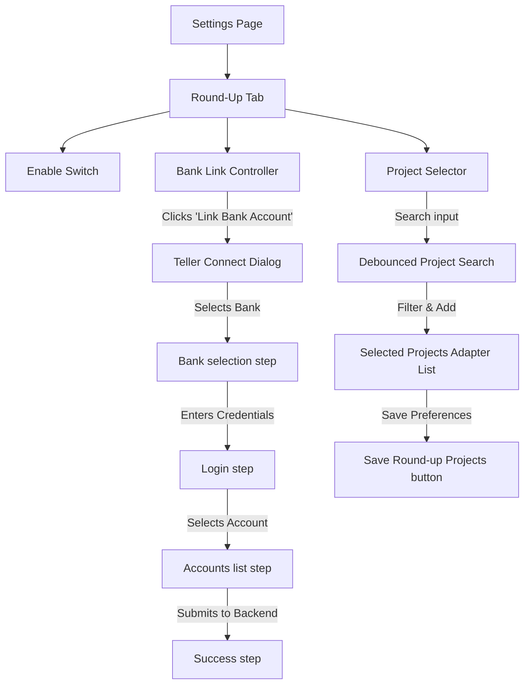

# Berry Bank Green Hub - Frontend

React application for tracking and supporting environmental projects.

## 🚀 Quick Start

```bash
# From project root
npm install
npm run dev
```

Access at **http://localhost:8000** (server serves both API and frontend)

## 🛠️ Tech Stack

- **Framework**: React 19 + TypeScript + Vite
- **UI**: Radix UI + Tailwind CSS
- **Routing**: React Router 7 (with Nested Layouts)
- **State Management**: Redux Toolkit (with 5-min caching)
- **Icons**: Lucide React + React Icons
- **Payments**: @stripe/stripe-js for secure checkout redirection and **Teller Connect** (bank linking for round-up donations)
- **Maps**: React Leaflet (with Backend Geocoding Proxy)
- **i18n**: Custom hook with multi-locale JSON support

### ⚙️ Round-up Settings Layout



## ⚡ Performance & Optimizations

The application implements several Next.js-inspired optimization patterns:

### 1. Routing & Rendering (Next.js Style)

- **Client-Side Rendering (CSR)**: The application follows a modern CSR architecture, optimized for high interactivity and reduced server load.
- **Persistent Layouts**: Uses React Router nested routes and `<Outlet />` to ensure the sidebar/header remains mounted during navigation.
- **Scroll Restoration**: Automatically scrolls to the top on every route change.
- **Link Prefetching (`AppLink`)**: Custom link component that triggers the `import()` of lazy-loaded page components on hover.
- **Unified Router Hook (`useRouter`)**: Simplified interface for `push`, `replace`, and `back`.

### 2. Loading & Performance Fundamentals

- **Code Splitting**: All pages are lazy-loaded via `React.lazy` and `Suspense` to reduce initial bundle size.
- **Skeleton States**: Implemented across all major views (`Projects`, `ProjectDetails`, `Profile`) using a custom `Skeleton` component to improve perceived performance and minimize layout shift.
- **HTTP-only Cookies**: The application uses secure, HTTP-only cookies for authentication, providing robust protection against token theft via XSS. All API requests automatically include credentials.
- **Role-Based Visibility**: Gamified elements like the "Growing Tree" and "Sunwater Coins" are automatically hidden for **Entity** accounts to maintain a professional partner dashboard experience.
- **Memoization**: Uses `useMemo` for expensive calculations and `memo` for reusable UI components (like `ProjectCard`) to prevent redundant re-renders.
- **Image Optimization**: `OptimizedImage` with lazy loading, priority loading for hero sections, and integrated skeleton states.

### 3. SEO & Metadata (`useSEO`)

Dynamic management of `document.title` and `<meta>` tags (OG, Description) for improved social sharing and discoverability.

### 4. Data Caching & Normalization

- **Normalization**: Project state is normalized using `createEntityAdapter`, enabling efficient CRUD operations and O(1) lookups by ID.
- **Cache TTL**: Redux slices implement a **5-minute cache TTL**. Fetched data is reused to reduce flicker and server load.
- **Memoization**: Heavy filtering and statistical calculations on the projects page use `useMemo` to prevent redundant re-renders.

## 🗺️ Routes

| Route               | Access       | Description                                                          |
| ------------------- | ------------ | -------------------------------------------------------------------- |
| `/`                 | Public       | Home page with featured projects (entities redirect to `/dashboard`) |
| `/projects`         | Public       | Browse approved projects                                             |
| `/project/:id`      | Public       | Project details                                                      |
| `/project/:id/edit` | Entity/Admin | Edit project details                                                 |
| `/profile`          | User         | Personal impact dashboard, round-up summary                          |
| `/settings`         | User         | Round-up projects, bank linking (Teller Connect)                     |
| `/dashboard`        | Entity/Admin | Partner management dashboard                                         |
| `/create`           | Entity/Admin | Project submission form                                              |
| `/auth`             | Public       | Login / registration                                                 |
| `/register-entity`  | Public       | Entity (organization) registration                                   |
| `/forgot-password`  | Public       | Password reset request                                               |
| `/reset-password`   | Public       | Password reset with token                                            |

## 🏢 Location Selection

The `LocationPicker` uses a **Backend Geocoding Proxy** (`/api/map/search`) to perform address lookups. This resolves CORS issues with Nominatim and allows for debounced, rate-limited requests for a smooth UX.

## 🌍 Internationalization (i18n)

Supported locales: **en-US**, **es-US**, **es-MX**, **pt-BR**.

Detection Priority: User preference > Server-side detection > IP-based Geolocation > Browser language.

---

## 🧪 Testing

```bash
npm run test:unit:client   # Run client unit tests (Jest)
npm run test:watch         # Watch mode
npm run test:e2e           # End-to-end tests (Playwright)
npm run test:e2e:ui        # E2E with interactive UI
npm run test:e2e:headed    # E2E in headed browser
```

## 📝 Commit Conventions

Commits are enforced via **Commitlint** (conventional commits). Use `feat:`, `fix:`, `chore:`, etc.

---

**Happy coding! 🌿**
