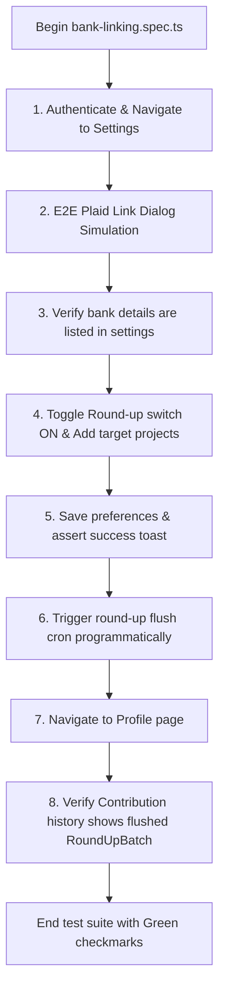

# Playwright E2E Tests

End-to-end tests for GreenInitiatives using [Playwright](https://playwright.dev/).

**Location:** `GreenInitiatives/e2e/`

## Running Tests Locally

### 1. Install browsers (first time only)

```bash
npx playwright install
```

### 2. Start the app

In one terminal:

```bash
npm run dev
```

### 3. Run tests

In another terminal:

```bash
npm run test:e2e
```

## Debugging: See Playwright Interact with the Browser

| Command                       | Description                                                                                                          |
| ----------------------------- | -------------------------------------------------------------------------------------------------------------------- |
| `npm run test:e2e:ui`         | **Best for debugging** — Opens Playwright’s UI where you can run tests, watch them step-by-step, and see the browser |
| `npm run test:e2e:headed`     | Run tests with a **visible** Chromium window (you see clicks and navigation)                                         |
| `npx playwright test --debug` | Opens **Playwright Inspector** — step through each action with pause/continue, inspect locators                      |
| `npx playwright test --ui`    | Same as `test:e2e:ui`                                                                                                |

For step-by-step debugging, use `--debug` or the UI mode (`test:e2e:ui`).

## Useful Commands

| Command                                  | Description                                     |
| ---------------------------------------- | ----------------------------------------------- |
| `npm run test:e2e`                       | Run all e2e tests (headless)                    |
| `npm run test:e2e:ui`                    | Open Playwright UI for debugging and watch mode |
| `npm run test:e2e:headed`                | Run tests with visible browser                  |
| `npx playwright test --project=chromium` | Run only Chromium                               |

## Configuration

- **Base URL:** `http://localhost:8000` (override with `PLAYWRIGHT_BASE_URL`)
- **Config:** `playwright.config.ts` (testDir: `./e2e`)
- **Tests:** `e2e/*.spec.ts`

## TODOs for More Tests

See the `TODO` comments in each spec file for suggested tests to add:

- **home.spec.ts** — Donor/entity redirects, search, i18n, growing tree
- **auth.spec.ts** — Full login flow, register entity, forgot/reset password
- **projects.spec.ts** — Project cards, funding, map, comments, 404
- **not-found.spec.ts** — Error boundary, offline handling
- **bank-linking.spec.ts** — E2E Plaid Link bank account linking, round-up project selection, and programmatic Cloud Scheduler cron flush verification.

## 🔄 E2E Test Verification Flow


