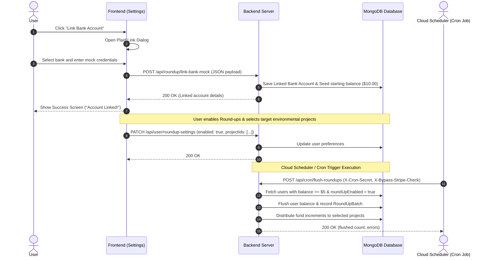

# Berry Bank Green Hub - Backend Server

Node.js/Express backend with MongoDB and In-Memory support.

## 🚀 Quick Start (Zero-Config)

```bash
# Install and run
npm install
npm run dev
```

The server will automatically start a `mongodb-memory-server` instance if no `MONGODB_URI` is provided.

## 🏗️ Architecture

**Tech Stack:** Node.js, Express, Mongoose, MongoDB, JWT, Stripe, WebSocket, TypeScript.

### Service Layer Architecture

The server implements a dedicated service layer (`server/services/`) to encapsulate business logic, separate from the Express controllers. This ensures cleaner controllers and better testability:

- **AuthService**: Manages password hashing, reset flows, and entity/org registration.
- **ProjectService**: Handles funding processing and impact verification.
- **PaymentService**: Encapsulates Stripe session creation, Financial Connections, and webhook handling.
- **RoundupService**: Round-up calculation, accumulation, and flush to projects.
- **DocumentStorageService**: Abstraction layer for document persistence and retrieval.

### Stripe & Plaid Integration

The server integrates with **Stripe API** for project funding and **Plaid API** for round-up bank feeds:

- **Checkout Sessions**: Dynamic session creation for project funding.
- **Local Payment Methods**: Added support for **OXXO** (Mexico) and **PIX** (Brazil).
- **Metadata**: Tracks `projectId` and `userId` directly in Stripe sessions for reconciliation.
- **Plaid Link Integration**: Bank linking for round-up donations/investing. Allows users to connect mock/sandbox or live bank accounts via Plaid.
- **Round-Up Service** (`roundup.service.ts`): Acorns-style accumulation in `User.roundUpBalanceCents`; flush when ≥ $5 via `POST /api/cron/flush-roundups` (with programmatic `X-Bypass-Stripe-Check` option for hermetic test execution).

### 🔄 Bank Linking & Cron Sequence Flow



### In-Memory MongoDB (`mongodb-memory-server`)

In development, sandbox, and test environments, the server boots a database-in-RAM. This allows for:

- **Instant Setup**: No local MongoDB installation required.
- **Isolated Testing**: CI pipelines run integration tests against a fresh memory instance, ensuring no state leakage between test suites.
- **Persistent Sessions**: Mock data is seeded into the memory DB, allowing for real CRUD testing during the server's uptime.
- **Local Inspection**: In dev (non-test), the memory server uses a fixed port **27018**. With the app running, connect via `mongosh mongodb://localhost:27018` and `use greenInitiatives` to inspect collections.

### Non-Blocking Startup

The server uses a non-blocking database connection strategy in `server/index.ts`. It starts listening for HTTP requests immediately while connecting to MongoDB in the background, ensuring high availability and faster cold starts on platforms like Google Cloud Run.

## 🔌 API Features

### Geocoding Proxy

To solve CORS and rate-limiting issues with Nominatim (OpenStreetMap), the server provides internal proxies:

- `GET /api/map/search?q=...`
- `GET /api/map/reverse?lat=...&lon=...`

### Real-Time Updates

WebSocket server (`server/websocket.ts`) provides live updates for project progress and community comments.

## 🔐 Authentication & Security

Uses **JWT-based auth** with reusable **Role-Based Access Control (RBAC)** middleware:

- `user`: Standard supporter (can comment and fund).
- `entity`: Organization partner (can create and manage own projects).
- `admin`: Full moderation, project approval, and flagged content management.

**REST Best Practices:**

- **HTTP-only Cookies**: JWT tokens are delivered via secure, HTTP-only cookies, eliminating the need for `localStorage` and significantly reducing XSS attack vectors.
- **NoSQL Injection Protection**: Uses `express-mongo-sanitize` to prevent malicious operator injection.
- **Production Safety Guards**: Implements triple-check logic (environment, cloud-detection, and URI inspection) to prevent mock data seeding in production.
- Semantically correct usage of `PATCH` for partial resource updates.
- Centralized `errorHandler` for consistent JSON error responses.
- `Zod` validation middleware for strict input sanitization.

## 🗄️ Database Schema

**Best Practices Implemented:**

- **Indexing**: Strategic indexes on `username`, `role`, `status`, and compound indexes for marketplace sorting.
- **Data Integrity**: Uses `mongoose.Schema.Types.ObjectId` for all cross-collection references.
- **Timestamps**: Automated `{ timestamps: true }` for all documents.

## 🌱 Mock Data Seeding

Dev/Sandbox environments automatically seed 5 pre-approved projects into the memory DB:

1. Solar Energy Farm (US)
2. Centro Comunitario Solar (Mexico)
3. Reforestação da Amazônia (Brazil)
4. Community Solar Fund - Ongoing (US, East Coast — open-ended donations)
5. Donate to BerryBank Green Fund (US, New York — direct donations to BerryBank, open-ended)

## 🧪 Testing

```bash
npm run test:unit:server # Run server unit tests (Jest + mongodb-memory-server)
npm run test:integration # Uses memory server for integration tests
```

CI runs server tests only when server source files (`.ts`) or shared source/test config change.

## 📝 Commit Conventions

Commits are enforced via **Commitlint** (conventional commits). Use `feat:`, `fix:`, `chore:`, etc.

---

**Happy coding! 🌿**
